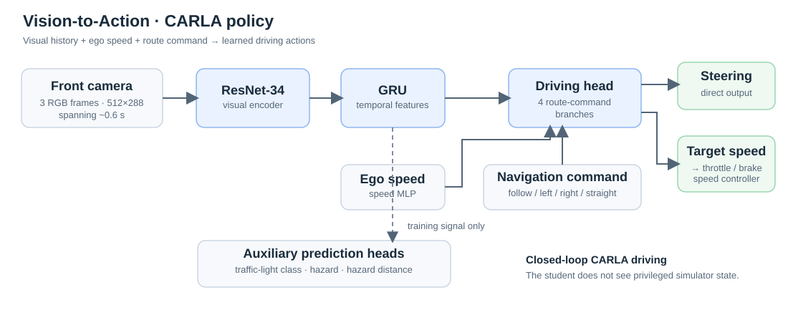

# Vision-to-Action

**Camera-based autonomous driving | Imitation learning · ResNet-34 + GRU · DAgger · CARLA**

An independent research project exploring how a neural network can **learn to steer and control vehicle speed from camera observations**, then improve through feedback on its own driving mistakes. Built an end-to-end data collection, training, closed-loop evaluation, and visualization pipeline in CARLA.

**[▶ Watch Driving Demo](https://youtu.be/2e8A-EQZihg)** · **[Full Benchmark](benchmarks/carla/README.md)** · **[Model Weights](benchmarks/carla/weights/pilot_v2_best_fp16.pt)**

> **Key result — 2× clean route success:** DAgger improved held-out CARLA route completion from **5/15 (33.3%)** with behavior cloning to **10/15 (66.7%)**. These are limited, simulator-only results—not an official CARLA Leaderboard score.

## Demo and results

The [78-second driving demo](https://youtu.be/2e8A-EQZihg) shows **three selected successful held-out routes**, with driving telemetry and model predictions overlaid. It illustrates what the model can do, but is not a representative sample of every run.

| Policy | Clean successes (15 routes) | Mean route completion | Collisions | Red-light violations |
| --- | ---: | ---: | ---: | ---: |
| Behavior cloning (v1) | 5/15 (33.3%) | 59.4% | 27% | 0 |
| **Behavior cloning + DAgger (v2)** | **10/15 (66.7%)** | **81.9%** | **13%** | **0** |
| Additional DAgger (v3) | 8/15 (53.3%) | 80.9% | 13% | 0 |
| Privileged CARLA expert | 11/15 (73.3%) | 96.3% | 7% | 3 |

**Evaluation:** Fifteen held-out Town10HD routes, approximately 300–800 m each. A clean success requires arrival at ≥95% route completion, **no collision, no road departure, no route deviation, and no red-light violation**. The traffic-light metric is a custom stop-zone check, not the official CARLA infraction system. Zero observed red-light violations on this small test does **not** establish traffic-light safety. The expert uses privileged simulator information; the learned model does not.

**[Inspect per-route results →](benchmarks/carla/results/pilot_v2_test_town10.csv)** · **[Read evaluation method and failure analysis →](benchmarks/carla/README.md)**

## Architecture: from pixels to driving actions

- **Visual and temporal perception:** Three 512 × 288 RGB frames sampled over ~0.6 seconds pass through an ImageNet-pretrained **ResNet-34** and a **GRU**.
- **Route-conditioned control:** Four navigation-conditioned output branches predict **steering** and **desired speed**, using vehicle speed as an additional input. A proportional controller translates target speed to throttle/brake.
- **Auxiliary supervision:** The network also learns traffic-light classification, hazard presence, and hazard distance. These predictions are **training and diagnostic outputs, not hand-coded inputs to control**.
- **Inference boundary:** The student receives only front-camera images, ego speed, and a high-level navigation command—not ground-truth vehicle positions, traffic-light states, or expert actions. Route planning happens outside the student model.

**Code:** [`model.py`](benchmarks/carla/model.py) · [`train.py`](benchmarks/carla/train.py) · [`run.py`](benchmarks/carla/run.py)

## Learning from mistakes

1. **Collect demonstrations:** Record driving labels from CARLA's privileged `BehaviorAgent` across training routes with vehicles, pedestrians, and different weather. The expert also uses a ground-truth-based hazard-braking adjustment during data collection.
2. **Behavior cloning:** Train a vision policy to imitate steering and desired speed. Split train/validation samples **by route**, not by nearby frames, to limit leakage.
3. **DAgger:** Let the student encounter the states caused by its own driving decisions while the expert labels corrective actions. Oversample turning, braking, and restarting moments rather than only easy straight-road frames.
4. **Closed-loop evaluation:** Test each policy driving the simulator—not just predicting actions on recorded images—and log route completion, collisions, deviations, and traffic violations.

**What the experiments taught:** The first DAgger round doubled clean successes on the held-out set. But more training was not automatically better: v3 fell to **8/15** on test, and v4 reached **6/10** on development routes (no v4 held-out test). A 10-route development set was not sufficient for reliable model selection.

**Code:** [`collect.py`](benchmarks/carla/collect.py) · [`dataset.py`](benchmarks/carla/dataset.py) · [`metrics.py`](benchmarks/carla/metrics.py)

## Research path

| Environment | Engineering question | Evidence |
| --- | --- | --- |
| **comma1M driving video** | Can real-camera data support useful trajectory prediction? | [`prepare_comma1m.py`](prepare_comma1m.py), [`train_comma1m_v2.py`](train_comma1m_v2.py) |
| **MetaDrive** | Can a camera-based policy learn closed-loop steering, and where does it fail? | [MetaDrive results and demos](benchmarks/metadrive/README.md) |
| **CARLA** | Can temporal vision learn steering and speed control through intersections and traffic? | [CARLA methods and benchmarks](benchmarks/carla/README.md) |

These are **different experiments with different metrics**; their success rates are not directly comparable.

## Reproduce / explore

The repository includes source code, test-route specifications, the best CARLA policy weights, per-route CSV/JSON results, unit tests, and the demo reel. Full raw training frames are not checked in.

- **[CARLA setup, expert collection, training, DAgger and evaluation](benchmarks/carla/README.md)**
- **[MetaDrive setup, experiments and reproducible tests](benchmarks/metadrive/README.md)**
- **[Best CARLA checkpoint](benchmarks/carla/weights/pilot_v2_best_fp16.pt)**
- **[Evaluation outputs](benchmarks/carla/results/)**

**Stack:** Python · PyTorch · torchvision · ResNet-34 · GRU · CUDA · CARLA · MetaDrive · OpenCV · Git

## Current limits and next research directions

This is an early-stage **simulation prototype**, not a safe or deployable autonomous-driving system. The CARLA study covers one town and a small held-out sample. The model still collides, misses route branches, and leaves the road; reliable pedestrian yielding and transfer to unseen towns are unverified.

Next priorities: **unseen-town evaluation**, larger held-out route sets, targeted collection of safety-critical and recovery cases, stronger temporal modeling, and comparisons on established autonomous-driving benchmarks.

---

**Siran Liu** · UBC MEng Mechatronics · BASc Manufacturing Engineering  
*Independent project; not affiliated with any company.*
